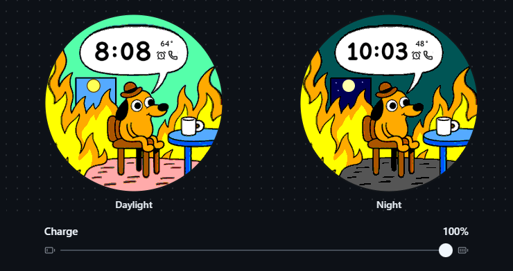
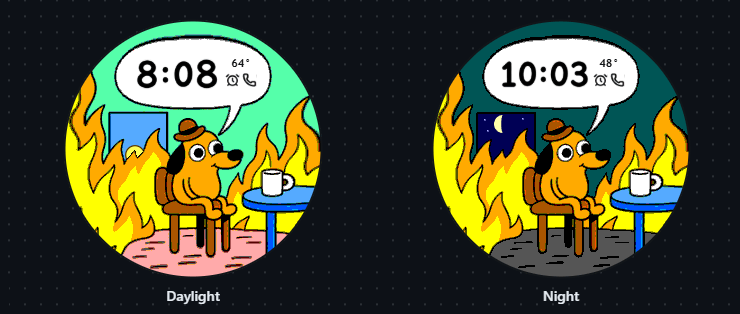

# This Is Fine

A Garmin watch face for my Fenix. Glance at the clock for the time, temperature, and phone connection. Raise your wrist and the dog takes a break from his coffee to assess the situation.

## Read the battery



*The sun sets and the moon wanes to represent your battery. The fire has its own power supply.*

By day, the last sliver of sun is still visible at 6% and disappears at 5%. At night, a full moon means a full charge. Its lit edge narrows as the battery drains.

## Raise your wrist



*Raise your wrist to see the protagonist's incident report alternating with the time (with a bonus incident report on low battery)*

The dog speaks at **0, 4, and 8 seconds**. The clock returns at **2 and 6 seconds**, then stays on at **10 seconds** as the fire goes still. The opening line is always **THIS IS FINE**. At 10% battery or below, the later reports read **SEND COFFEE**. An earlier sleep signal ends the animation immediately.

The flames rise and sway at four frames per second. The face uses Garmin’s wake notification for the same sequence whenever the system wakes it. On the fēnix 6, the LIGHT button can illuminate the display without sending that notification.

## At a glance

| On the face | What it means |
| --- | --- |
| Clock | Local time in the watch's 12- or 24-hour format. At rest, it updates once a minute and the fire stays still. |
| Temperature | Garmin's cached weather in the watch's preferred units. `--°` means the reading is missing or more than three hours old. |
| Alarm clock | At least one alarm is set. The icon disappears when there are none. |
| Phone receiver | The phone is connected. A diagonal line through the receiver means it is disconnected. |

The temperature and status icons share the clock bubble. Day and night follow sunrise and sunset at the cached weather station, without starting GPS. When those times are unavailable, daylight runs from 07:00 to 19:00 local time.

## Build and install

The target is the 47 mm fēnix 6 Sapphire with a 260 × 260 MIP display. In Garmin Connect IQ SDK Manager, install an SDK and select **Devices → API level 3.4 → fēnix 6 Pro / 6 Sapphire**. The product ID is `fenix6pro`.

1. With Java 11 or later installed, run this from the project folder in PowerShell 7.

   ```powershell
   .\tools\build.ps1
   ```

2. Connect the watch by USB. In Windows File Explorer, open **This PC → fenix 6 Sapphire → Primary → GARMIN → Apps**. Copy **`bin\ThisIsFine.prg`** directly into **Apps**, alongside the `LOGS`, `DATA`, and `SETTINGS` folders.
3. Disconnect the watch. From the watch face, hold **MENU**, choose **Watch Face**, select **This Is Fine**, and press **START → Apply**.

The Windows build script creates a local signing key for future updates. To use an existing key, pass `-DeveloperKey`. On macOS or Linux, build with the SDK compiler and your signing key.

```sh
mkdir -p bin
monkeyc -f monkey.jungle -d fenix6pro -y /path/to/developer_key.der -r -w -l 3 -o bin/ThisIsFine.prg
```

## Development

With the Connect IQ simulator open and the SDK's `bin` directory on your PATH, run the device tests from the project folder.

```powershell
.\tools\build.ps1 -Mode Tests
monkeydo.bat build\tests\ThisIsFine-tests.prg fenix6pro /t
```

The tests cover drawing the clock and animation frames, dialogue timing, the battery cutoff, time and temperature formats, and day/night transitions. To check all 101 battery levels against all four fire poses, install `tools/requirements.txt` and run `python tools/verify_art.py`.

To edit the fire motion, adjust the flame tips in `tools/animate_fire.py`, run that script, then run `python tools/prepare_art.py` to rebuild the watch resources.
